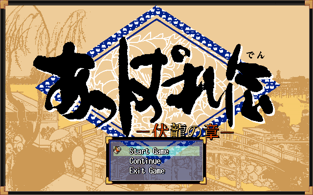

# appareden


Romhacking utilities and notes developed as part of [46 OkuMen](http://46okumen.com/)'s English translation patch for *Appareden - Fukuryuu no Shou* (あっぱれ伝 ー伏龍の章ー) (PC-98), a traditional and colorful JRPG based on Japanese history and myth.

### Draft Reinsertion Progress


| Segment      | %    |  Strings            |
| -------------|-----:|:-------------------:|
| ORTITLE.EXE  | 100%  | (18 / 18)           |
| ORFIELD.EXE  | 99%   | (1322 / 1326)       |
| ORBTL.EXE    | 100%  | (792 / 792)         |
| Dialogue     | 100%  | (5601 / 5592)       |
| Images       | 94%   | (52 / 55)           |
| **Total**    |**100%**|  **(7785 / 7783)**  |

### Requirements
* A working hard-disk dump of *Appareden*
* [romtools](https://github.com/46OkuMen/romtools)
* xlsxwriter
* openpyxl
* Bitstring
* nosetests
* ndcpy

### Running Tests
`nosetests test.py` - a few sanity checks

### Building
This requires an existing HDI of Appareden, such as the one from the Neo Kobe pack. The utilities should work on the (developer-) patched or unpatched versions.
Place your dump of `Appareden.hdi` in the subfolder `original`. Then run these scripts to dump the system text, dialogue, and pointers:

```
python sys_dump.py
python msg_dump.py
python find_pointers.py
```

Translate the script, which is dumped into `appareden_sys_dump.xlsx` and `appareden_msg_dump.xlsx`.

Now create a subfolder `patched`, where another copy of `Appareden.hdi` should go. Now run these to reinsert text and images:

```
python typeset_script.py
python reinsert.py
python gem.py
```

Now, `patched/Appareden.hdi` should be playable in English as far as you've translated.

### Main scripts
* sys_dump.py - dumps text from system files (ORTITLE.EXE, ORFIELD.EXE, ORBTL.EXE) into appareden_sys_dump.xlsx.
* msg_dump.py - dumps text from dialogue files (a few hundred .MSG files) into appareden_msg_dump.xlsx.
* find_pointers.py - dumps pointers into appareden_pointer_dump.xlsx.
* typeset_script.py - adds line breaks where necessary into the translated column of the .MSG files.
* reinsert.py - Replaces the JP strings with the translated ones in the dump excel, adjusts pointers, and reinserts the translated files into the HDI.

### Other scripts (used by the above)
* gem_codec.py - decoder and size-optimizing encoder for the .GEM image format, written from the game's own decoder. Its docstring is the format reference.
* ending_overline.py - ASM patch for ENDING.EXE so the credits show macrons (Jado~ -> Jadō), using user-defined characters; applied through asm.py's FD_EDITS/CD_EDITS by reinsert.py.
* spz.py - reader/writer for .SPZ sprite tables (which 16x16 tiles of a .GEM sheet make up each sprite), written from NEKORUN.EXE's sprite drawer.
* nrchr_text.py - renders the English "Ah!" / "There it is!!" / "Wait!!" sprites for the Neko Run minigame and repacks them into NRCHR_99.GEM/.SPZ (called from gem.py).
* automation/ - drives the game headless under np2core: replays scenes, renders every message block of every scene for text QA, and opens every shop to check description widths (see automation/README.md).
* rominfo.py - maps out many properties of the game files, including text blocks, pointer blocks, control codes, etc.
* asm.py - holds the ASM strings used for various text/game modification hacks. Some will be in the final patch (text compression routines, bugfixes), others are just for testing ("turn off random battles" cheat, etc).
* pointer_info.py - list of pointers to reassign. There are lots of duplicate strings - we can save space by re-pointing duplicates to the same text location.
* portraits.py - list of portraits and their character/emotion.
* utils.py - helper functions.

### One-time utility scripts
* dictionary.py - counts the words in ORFIELD/ORBTL and generates a compression dictionary for each. The dictionary is then inserted into the first string in each file.
* replace_title.py - for easily viewing a GEM image. Give it the filename of a GEM image in patched/, and it will replace the title screen with it.
* portraitcrop.py - crop the fullscreen portraits.
* tools/find_cd_diffs.py - determine the text-block location differences between the FD and CD versions.
* n.py - explorative script for trying different control-code values for a line break.

### License
This project is licensed under the Creative Commons A-NC License - see the [LICENSE.md](LICENSE.md) file for details.
